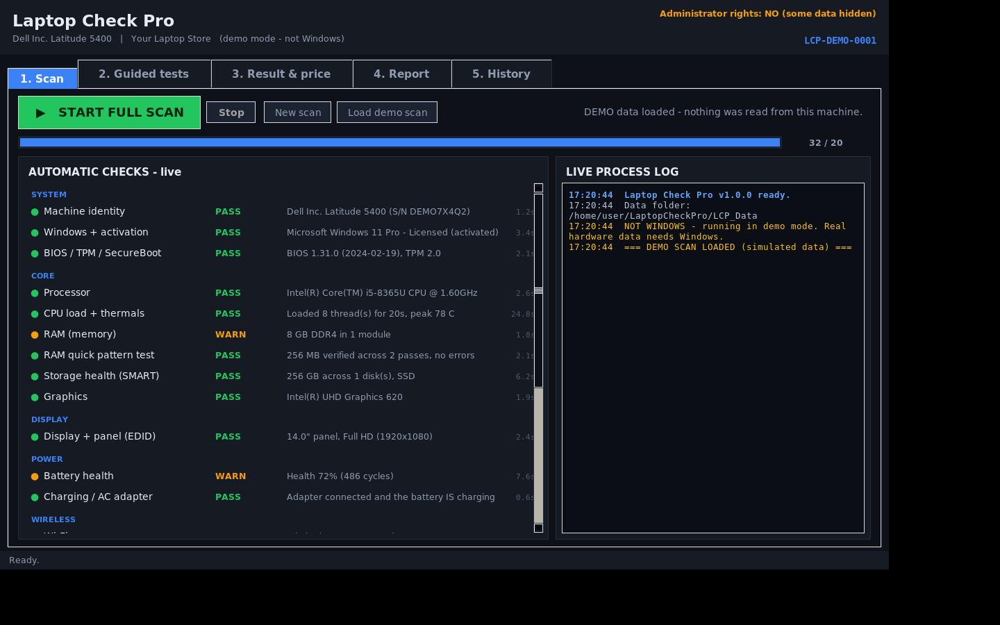
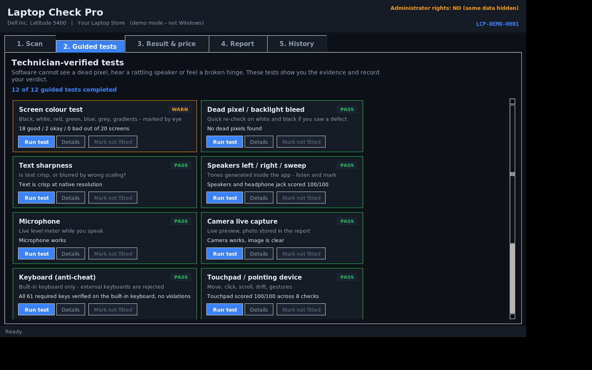
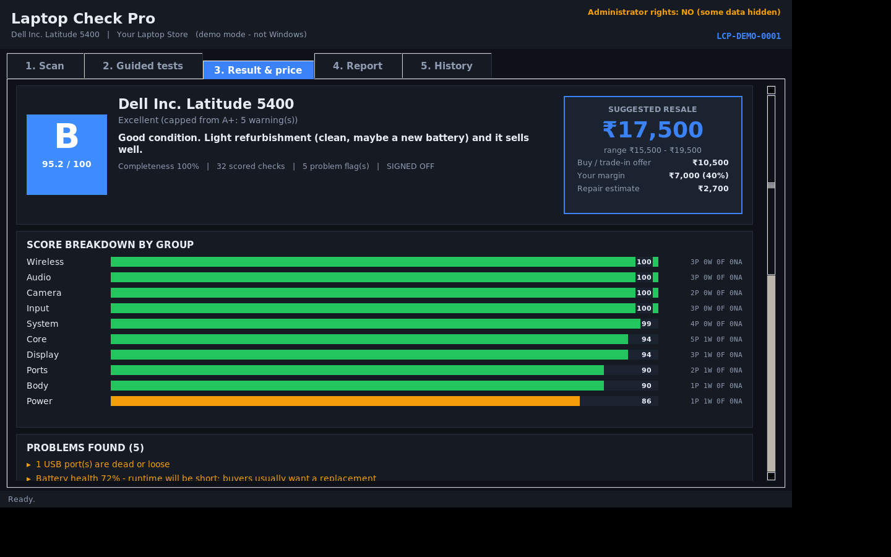
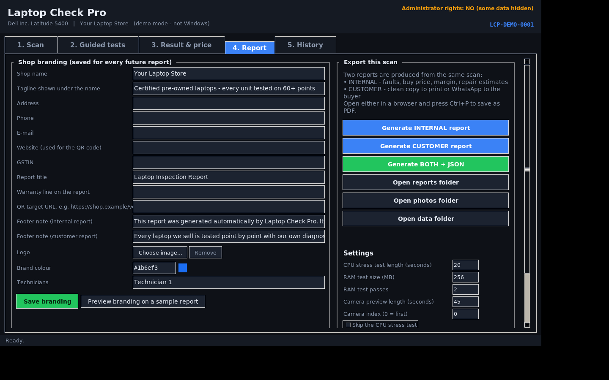

# Laptop Check Pro

**The inspection tool for shops that buy and sell used laptops.**

One `.exe`. Double-click it on any Windows 10/11 laptop and it tests the
machine in front of you — display, battery, RAM, storage, CPU, sound, camera,
keyboard, ports, wireless, Windows licence — while showing you every step live
on screen. At the end it gives the laptop a **condition grade (A+ … E)** and a
**resale price in rupees**, and prints a branded report you can hand to the
customer or keep for your own books.

Built for Indian second-hand laptop dealers: prices are in ₹, the pricing
model is calibrated on real Indian used-market listings, and the report is
written the way a shop actually sells — internal copy with buy price and
margin, clean copy for the customer.

---

## Quick Start

**You do not install anything. There is no setup, no Python, no dependencies.**

1. Go to **[Releases](https://github.com/cid0980/Laptop-check/releases)** and
   download `LaptopCheckPro.exe` (or grab the latest build artifact from
   [Actions](https://github.com/cid0980/Laptop-check/actions/workflows/build-exe.yml)).
2. Copy it anywhere on the shop PC — desktop is fine.
3. **Double-click it.** Windows shows a UAC shield prompt: click **Yes**.
   (Admin rights are what let the tool read drive health (SMART), CPU
   temperatures and the display panel's EDID. Without them it still works,
   just with less detail, and says so.)
4. Press **START FULL SCAN** and watch it work. Nothing is blank: every check
   shows its live status, what it found and how long it took.
5. Switch to **Guided tests** and run the human-judged ones — screen colours,
   speakers, mic, camera, keyboard, ports, cosmetics, sign-off. Each one shows
   its own evidence window.
6. Open **Result & price** for the grade and the ₹ valuation, then **Report**
   to put your shop name on it and export.

> First run on a new PC takes a few seconds while Windows unpacks the exe.
> Everything the tool saves (reports, photos, branding, price model) lives in
> a `LCP_Data` folder next to the exe — delete the exe and the data stays,
> copy both to a new PC and your history comes with you.

### The three-minute workflow per laptop

| Step | Tab | What you do |
|---|---|---|
| 1 | **Scan** | Press START. ~2–4 min, fully automatic, live on screen. |
| 2 | **Guided tests** | 12 cards. Run each; mark what you see with one keypress. |
| 3 | **Result & price** | Read the grade and the price breakdown. |
| 4 | **Report** | Export. Internal copy for you, customer copy for them, Ctrl+P → PDF. |

---

## What it checks

**Automatic (20 checks) — the machine answers for itself**

| Group | Checks |
|---|---|
| System | machine identity & serial • Windows edition + **activation/licence** + firmware OEM key • BIOS/UEFI, **TPM 2.x, Secure Boot**, Windows 11 readiness • event-log hardware errors (WHEA) |
| Core | CPU model/generation/throttle history • **CPU burn test with live temperature** • RAM size/slots/channel • **RAM pattern test** • **storage SMART health, wear %, power-on hours** • GPU |
| Display | panel from EDID: maker, native resolution, size, manufacture week |
| Power | **battery health % vs design capacity, cycle count** (from `powercfg /batteryreport`) • charger/AC state |
| Wireless | Wi-Fi adapter + driver + radio state • Bluetooth • Ethernet |
| Audio / Camera / Ports / Input | output & input endpoints • camera device + privacy consent • USB controllers & ports • keyboard/touchpad device inventory |

**Guided (12 tests) — the human eye and ear, recorded properly**

- **Screen colours** — 20 full-screen patterns (black, white, red, green,
  blue, greys, gradients, grey steps, checkerboard, 1-pixel lines, geometry
  grid, corner bleed test). The control panel auto-hides so it can never hide
  a defect. Mark each **Good / Okay / Bad** with one key.
- **Dead pixels & backlight bleed**, and **text sharpness** — derived from the
  same single pass, so you only look once.
- **Speakers** — tones generated inside the app (left, right, sweep); you mark
  what you hear. **Microphone** — live level meter while you speak.
- **Camera** — real live preview (DirectShow), photo saved into the report.
- **Keyboard** — all 61 required keys on a full-screen map, **anti-cheat**:
  Raw Input + a low-level hook classify every keypress by *device*, so an
  external USB/Bluetooth keyboard, a remote-desktop session or a macro tool
  cannot fake the built-in keyboard. Overrides are recorded as flags.
- **Touchpad**, **USB port plug-test** (the tool *detects* the pen drive
  appearing — no trusting), **HDMI / headphone jack / card reader**
  (auto-detected on plug-in), **14-point cosmetic & safety inspection** with
  photos, and **technician sign-off**.

**Missing hardware is never an error.** No Wi-Fi? No camera? No Bluetooth?
The report says **NOT FITTED** and excludes it from the score instead of
failing the machine.

---

## The grade and the price

- **Grade A+ … E** from a weighted health score (32 checks), with hard caps:
  a failing drive, a tampered keyboard test or liquid damage can never be
  hidden by good scores elsewhere.
- **Price = base value of the CPU generation** (the real driver of used-laptop
  value in India) **+/-** RAM, storage, display, GPU, Windows 11 support,
  licence, age **×** condition & cosmetic multipliers **−** an itemised
  deduction for every fault found.
- Every rupee is on its own line in the report, so you can argue with the
  model. It also prints a **suggested range**, a **buy/trade-in offer** and
  your **margin**.
- All numbers live in `LCP_Data/pricing.json` — edit it to match your own
  street prices. No rebuild needed.

## The report

One self-contained HTML file (photos embedded, no internet needed), printable
to PDF from any browser:

- **Internal copy** — faults, flags, buy price, margin, repair estimates,
  integrity section, full process log.
- **Customer copy** — clean, branded, warranty line, QR code to your
  verification page if you set one up.
- Your **shop name, logo, colours, address, GSTIN, technicians** are stored
  once on the Report tab and reused forever.
- Every export appends a row to `LCP_Data/inventory.csv` — your stock ledger.
- Scan history stays on the PC; re-open any past scan and re-print it.

---

## Screenshots

| | |
|---|---|
|  |  |
| *Live automatic scan — every check visible as it runs* | *Guided test board with per-test verdicts* |
|  |  |
| *Grade, group scores, itemised ₹ price* | *Shop branding + export* |

---

## Building it yourself (developers)

The app is **100 % Python standard library** — tkinter GUI, ctypes Win32 /
DirectShow / winmm, PowerShell + CIM for hardware data. No OpenCV, no numpy,
no Pillow, no pywin32.

```bat
git clone https://github.com/cid0980/Laptop-check.git
cd Laptop-check
tools\build.bat          :: one click: self-test + PyInstaller onefile
```

or by hand:

```bat
py -3.11 -m pip install pyinstaller
py -3.11 run.py --selftest
py -3.11 -m PyInstaller LaptopCheckPro.spec --noconfirm
```

The packaged exe is `dist\LaptopCheckPro.exe` (single file, UAC-admin,
no console window, custom icon).

**Continuous build:** every push to `main` runs the headless self-test and
PyInstaller on GitHub Actions (`windows-latest`, Python 3.11) and keeps the
exe as a downloadable artifact; pushing a `v*` tag also creates a GitHub
Release with the exe attached. See `.github/workflows/build-exe.yml`.

**Useful switches** (same exe):

```
LaptopCheckPro.exe --demo                GUI with a simulated scan
LaptopCheckPro.exe --selftest            headless: demo scan -> report, exit code
LaptopCheckPro.exe --report-from X.json  re-render a saved scan
LaptopCheckPro.exe --camera-list         headless camera inventory
```

## Project layout

```
run.py                  single entry point (GUI + headless modes)
app/                    core types, PNG & QR encoders, grading, valuation,
                        branding, report engine, GUI, DirectShow camera
collectors/             everything that reads hardware automatically
guided/                 the 12 human-judged test dialogs
tools/                  build.bat, make_icon.py
docs/                   screenshots
.github/workflows/      repeatable Windows exe build + release
```

## Roadmap

- **v1.x** — Windows hardening from real shop use, pricing model tuning.
- **v2.0** — macOS build (system_profiler / ioreg collectors, same report).
- Label-printer export, WhatsApp-ready customer summary page.

## Licence

MIT — see [LICENSE](LICENSE). Use it in your shop, free forever.
